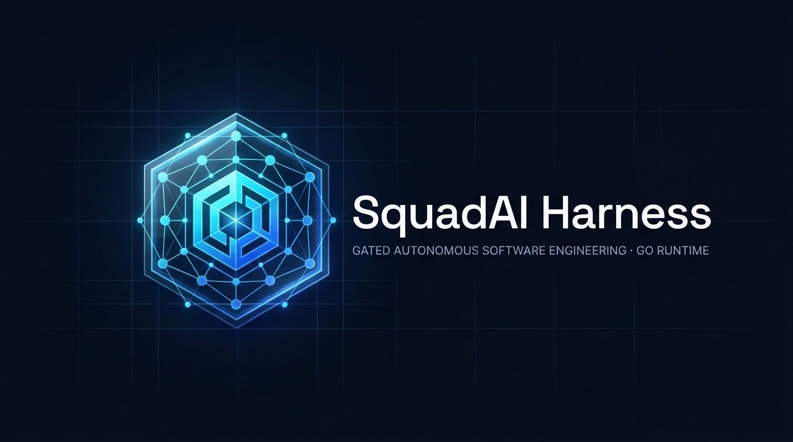

# SquadAI Harness — Official Releases (v1.0.113)

  

  <!-- Matriz de Plataformas e Tecnologias Suportadas -->
  <table>
    <thead>
      <tr>
        <th align="left">Domínio</th>
        <th align="left">Plataformas e Tecnologias Suportadas</th>
      </tr>
    </thead>
    <tbody>
      <tr>
        <td nowrap="nowrap"><strong>📦 Release &amp; Ambiente</strong></td>
        <td align="left">
          
          
          
          
        </td>
      </tr>
      <tr>
        <td nowrap="nowrap"><strong>☕ Backend &amp; Sistemas</strong></td>
        <td align="left">
          
          
          
          
          
          
        </td>
      </tr>
      <tr>
        <td nowrap="nowrap"><strong>🐍 Python, Web &amp; UI</strong></td>
        <td align="left">
          
          
          
          
          
        </td>
      </tr>
      <tr>
        <td nowrap="nowrap"><strong>☁️ AWS, Serverless &amp; IaC</strong></td>
        <td align="left">
          
          
          
          
          
          
        </td>
      </tr>
      <tr>
        <td nowrap="nowrap"><strong>🗄️ Dados, Obs, AppSec &amp; QA</strong></td>
        <td align="left">
          
          
          
          
          
        </td>
      </tr>
      <tr>
        <td nowrap="nowrap"><strong>🤖 IA Agêntica, GPU &amp; MCP</strong></td>
        <td align="left">
          
          
          
          
        </td>
      </tr>
    </tbody>
  </table>

---

## 1. O que é o SquadAI Harness

O **SquadAI Harness** é uma ferramenta de apoio à engenharia de software que disponibiliza especialistas técnicos (arquitetura, desenvolvimento backend/frontend, banco de dados, nuvem AWS, testes e segurança) diretamente na sua IDE ou terminal via **Model Context Protocol (MCP)**.

Este repositório (`squad-ai-harness-releases`) reúne os **instaladores oficiais**, os **guias de uso** e os **scripts de verificação de segurança** da versão `v1.0.113`.

---

## 2. Ferramentas e IDEs Compatíveis

O instalador provisiona as **113 skills especializadas** seguindo a regra de **Pastas Padrão no `$HOME`** e **Detecção Automática**:

- **Provisionadas por padrão no `$HOME` (`%USERPROFILE%`) mesmo que ainda não existam:**
  - **Claude Code / Cowork** (`~/.claude/skills`)
  - **OpenAI Codex CLI** (`~/.codex/skills`)
  - **Google Antigravity** (`~/.gemini/config/skills`) e **Gemini CLI** (`~/.gemini/skills`)
  - **GitHub Copilot Agent** (`~/.copilot/skills`)
- **Provisionadas automaticamente quando já instaladas na máquina:**
  - **Cursor IDE** (`~/.cursor/skills`)
  - **Windsurf IDE** (`~/.codeium/windsurf/skills`)
  - **Cline / Roo Code** (`~/.cline/skills`), **Qwen Code CLI** (`~/.qwen/skills`), **DeepSeek Harness** (`~/.dsh/skills`), **OpenCode CLI** (`~/.opencode/skills`) e **Workstation CLI**

---

## 3. Requisitos de Sistema

| Sistema Operacional | Arquiteturas | Requisitos Mínimos |
|---|---|---|
| **Windows 10 / 11** | `amd64`, `arm64` | Git Bash (`bash`) e Prompt de Comando (`cmd.exe`), 4 GB RAM, 200 MB em disco |
| **Linux (Ubuntu 22.04+, Debian 12+)** | `amd64`, `arm64` | Terminal padrão (`bash`), 4 GB RAM, 200 MB em disco |
| **macOS 14+** | `arm64`, `amd64` | Terminal padrão, 4 GB RAM, 200 MB em disco |

---

## 4. Como Instalar, Reinstalar e Desinstalar (Todos os SOs: Repositório ou Releases)

Os scripts instaladores (**`setup-squad-ai.sh`**, **`setup-squad-ai-windows.sh`**, **`setup-squad-ai-linux.sh`** e **`setup-squad-ai-macos.sh`**) ficam **mantidos diretamente na raiz deste repositório** (além da aba **Releases**), permitindo instalar tanto baixando/clonando o repositório quanto baixando apenas o arquivo `.sh`. Ao final da execução, o instalador exibe um banner explícito de confirmação **`[SUCESSO]`** ou **`[FALHA]`**.

### Opção A — Baixando ou Clonando o Repositório (Recomendado)

Em redes corporativas onde o proxy/firewall bloqueia downloads de `releases/download`, basta clonar este repositório (ou clicar no botão verde **`<> Code -> Download ZIP`** do GitHub) e executar o `.sh` diretamente na raiz do repositório em **qualquer Sistema Operacional**:

    git clone https://github.com/thiago701/squad-ai-harness-releases.git
    cd squad-ai-harness-releases

    # Windows 10 / 11 (Git Bash):
    bash ./setup-squad-ai-windows.sh

    # Linux (Ubuntu, Debian, Mint, RHEL, Fedora, WSL2):
    bash ./setup-squad-ai-linux.sh

    # macOS (Apple Silicon M1-M4 / Intel):
    bash ./setup-squad-ai-macos.sh

    # Ou use o instalador universal multi-SO presente na raiz:
    bash ./setup-squad-ai.sh

### Opção B — Baixando Apenas o Arquivo Único `.sh` da Aba Releases (Sem Clonar Repositório)

1. Acesse a aba **[Releases](../../releases/latest)** (ou clique no arquivo direto na raiz deste repositório) e baixe o instalador do seu Sistema Operacional (`setup-squad-ai-windows.sh`, `setup-squad-ai-linux.sh` ou `setup-squad-ai-macos.sh`).
2. Abra o **Git Bash / Terminal** e execute o Setup Wizard interativo (`[1] INSTALAR`, `[2] REINSTALAR`, `[3] DESINSTALAR`, `[4] AUDITORIA`, `[5] LIGAR MCP`, `[6] VALIDAR PORTA`, `[7] RELATORIO MCP`) ou passe a flag diretamente:

       # Instalar (valida a chave de licença individual 100% offline e descriptografa as 113 skills)
       bash ./setup-squad-ai-windows.sh --install --pin <CHAVE_LICENCA_INDIVIDUAL>

       # Reinstalar / Reparar preservando o Identificador (QID) da estação
       bash ./setup-squad-ai-windows.sh --reinstall --pin <CHAVE_LICENCA_INDIVIDUAL>

       # Auditoria de Homologação Corporativa (8 Gates + Laudo JSON em Sandbox)
       bash ./setup-squad-ai-windows.sh --audit

       # Verificar status do Servidor MCP / Porta / Relatório MCP
       bash ./setup-squad-ai-windows.sh --serve-mcp
       bash ./setup-squad-ai-windows.sh --check-port
       bash ./setup-squad-ai-windows.sh --report-mcp

       # Desinstalação Seletiva (remove apenas as skills da SquadAI, mantendo as demais skills do dev)
       bash ./setup-squad-ai-windows.sh --uninstall

### Pacote Nativo Debian/Ubuntu (`.deb`) para Linux (Opcional)

       sudo dpkg -i squad-ai-harness_1.0.113_amd64.deb

Consulte o passo a passo completo em [docs/installation.md](docs/installation.md) e [docs/TUTORIAL_INSTALACAO_E_MCP_REMOTO.md](docs/TUTORIAL_INSTALACAO_E_MCP_REMOTO.md).

---

## Como Usar na sua IDE

Após concluir a instalação, abra o chat da sua IDE (**Claude Code**, **Google Antigravity**, **GitHub Copilot**, **Cursor**, **Windsurf** ou **Codex**) e envie comandos em linguagem natural:

| Objetivo | Exemplo de Comando no Chat da IDE |
|---|---|
| **Iniciar um projeto ou funcionalidade com a equipe completa** | `"Squad ai, prepare a equipe"` |
| **Listar todos os 113 especialistas e domínios disponíveis** | `"Squad ai, quais suas habilidades?"` |
| **Projetar dashboards executivos e analíticos (Zero-JS / SSR)** | `"Squad ai, crie um dashboard executivo com o intelligent-dashboard-engineer"` |
| **Investigar a causa raiz de um erro ou falha de build/runtime** | `"Squad ai, investigue a causa raiz deste erro"` |
| **Revisar código com foco em arquitetura, segurança e performance** | `"Squad ai, revise este código com o Tech Lead e Engenheiro de Segurança"` |
| **Exibir o relatório executivo de uso e economia de tokens** | `"Squad ai, gere relatorio de uso"` |

---

## 5. Ativação e Troca de Computador

### Ativar na estação atual
Após instalar, ative sua estação informando seu e-mail cadastrado:

    squad-harness license activate --email seu.nome@empresa.com

### Transferir para um novo computador (ou após formatação)
Caso troque de computador ou formate o sistema operacional, recupere seu acesso na nova máquina:

    squad-harness license recover --email seu.nome@empresa.com --otp <CODIGO-VERIFICACAO>

Mais informações em [docs/licensing.md](docs/licensing.md).

---

## 6. Verificação de Integridade e Homologação de Segurança (InfoSec)

Antes de instalar ou distribuir internamente, você ou a equipe de Segurança da Informação da sua empresa podem validar a integridade dos arquivos e executar a checagem automatizada de conformidade:

### Conferir o Checksum `SHA-256`

No **Git Bash / Linux / macOS**:

    sha256sum setup-squad-ai-windows.sh setup-squad-ai-linux.sh setup-squad-ai-macos.sh
    cat manifests/releases/SHA256SUMS.txt

### Executar o Script de Homologação para Equipes de Segurança

No **Windows CMD (`cmd.exe`)**:

    audit\audit-infosec.cmd

No **Git Bash / Linux / macOS (`bash`)**:

    bash ./audit/verify-infosec-homologation.sh

Documentação para equipes de segurança e governança:
- [Roteiro de Homologação de Segurança Corporativa](docs/ROTEIRO_HOMOLOGACAO_SEGURANCA_CORPORATIVA.md)
- [Guia de Conformidade Corporativa](docs/enterprise-compliance.md)
- [Diretório de Evidências e Relatórios (`enterprise-compliance/`)](enterprise-compliance/README-AUDIT.md)

---

## 7. Perguntas Frequentes (FAQ)

- **Para instalar pelo `setup-squad-ai-windows.sh` preciso clonar o repositório ou descompactar algum `.zip`?**
  Não. Os instaladores da aba **[Releases](../../releases/latest)** (`setup-squad-ai-windows.sh`, `setup-squad-ai-linux.sh` e `setup-squad-ai-macos.sh`, `4,04 MB`) são 100% autossuficientes e trazem todas as **113 skills completas** embutidas. Basta baixar o arquivo `.sh` do seu SO e executar no Git Bash / Terminal.
- **O instalador do Windows precisa do PowerShell ou de permissão de Administrador?**
  Não. O instalador `setup-squad-ai-windows.sh` funciona diretamente via **Git Bash (`bash`)** em um único arquivo auditável, instalando as skills apenas na pasta do próprio usuário (`%USERPROFILE%`) e exibindo confirmação explícita de `[SUCESSO]` ou `[FALHA]` no final.
- **Como a equipe de Segurança da Informação pode auditar o instalador?**
  Basta executar `bash ./setup-squad-ai-windows.sh --audit` (ou escolher a opção `[4] AUDITORIA` no menu). O instalador executa os 8 Gates de verificação em Sandbox isolado e gera o laudo `homologation-audit-report.json`.
- **Como atualizo ou reparo uma instalação existente?**
  Basta executar `bash ./setup-squad-ai-windows.sh --reinstall` (ou opção `[2] REINSTALAR` no menu). Suas configurações locais e seu Identificador (`QID`) são preservados.
- **A desinstalação apaga as minhas próprias skills pessoais?**
  Não. Ao executar `bash ./setup-squad-ai-windows.sh --uninstall` (ou opção `[3] DESINSTALAR` no menu), o desinstalador remove **apenas as skills que pertencem à SquadAI**, preservando todas as demais skills criadas pelo desenvolvedor em todas as ferramentas (inclusive no Workstation CLI).

---

## 8. Documentação e Suporte

- [Visão Geral](docs/overview.md)
- [Arquitetura de Integração](docs/architecture.md)
- [Guia de Instalação](docs/installation.md)
- [Ativação e Troca de Computador](docs/licensing.md)
- [Solução de Problemas (Troubleshooting)](docs/troubleshooting.md)
- [Conformidade e Homologação de Segurança](docs/enterprise-compliance.md)
- [Política de Segurança](SECURITY.md) · [Privacidade](PRIVACY.md) · [Termos de Uso](LICENSE.md)
