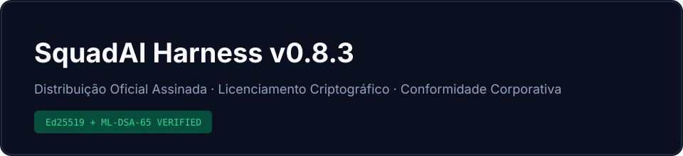
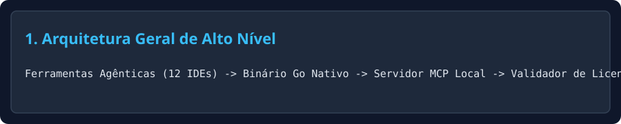
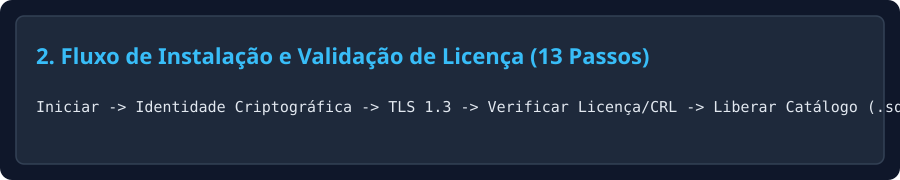
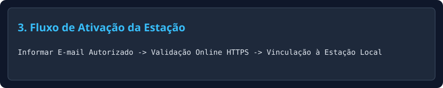
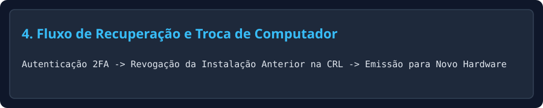
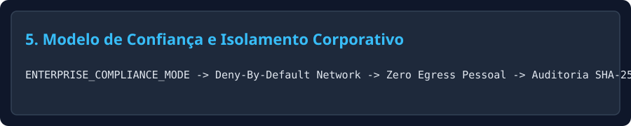
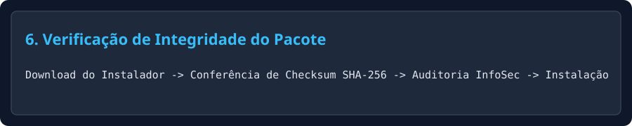

# SquadAI Harness — Official Releases (v0.8.3)

---

## 1. Visão Executiva

O **SquadAI Harness** é uma plataforma corporativa de engenharia de software assistida por múltiplos especialistas coordenados, distribuída como **binário nativo assinado digitalmente** e integrada via **Model Context Protocol (MCP)** às principais ferramentas de desenvolvimento do mercado.

Este repositório (**SquadAI Harness — Official Releases** · `squad-ai-harness-releases`) é o **canal oficial público de distribuição, verificação de integridade, documentação operacional e conformidade corporativa**.

---

## 2. Problema que Resolve

Equipes de engenharia que adotam assistentes de IA enfrentam quatro desafios críticos em produção:
1. **Deriva arquitetural e ausência de governança** entre diferentes IDEs e ferramentas agênticas.
2. **Risco de segurança e vazamento de propriedade intelectual** ao executar scripts interpretados sem controle de integridade.
3. **Custo elevado de tokens e latência** em decisões repetitivas de revisão, conformidade e qualidade.
4. **Falta de rastreabilidade executiva** sobre horas economizadas, qualidade de entrega e conformidade regulatória.

---

## 3. Proposta de Valor

- **Execução Local Determinística (< 1 ms):** Motor nativo com verificação criptográfica de licença em memória (`< 1 µs`).
- **Integração Multi-Ferramenta via MCP (12 Ferramentas):** Opera simultaneamente com Claude Code, Google Antigravity, Cursor, GitHub Copilot, Codex CLI, Windsurf, Gemini CLI, Cline/Roo Code, Qwen Code, DeepSeek Harness, OpenCode e Resolve AI.
- **Proteção Integral de Propriedade Intelectual:** Catálogo de especialistas cifrado (`ML-KEM-768 + AES-256-GCM`) e liberado exclusivamente em memória mediante licença válida vinculada ao equipamento.

---

## 4. Arquitetura de Alto Nível

Consulte o detalhamento arquitetural em [docs/architecture.md](docs/architecture.md).

---

## 5. Diferenciais Técnicos

| Dimensão | Implementação Oficial SquadAI Harness |
|---|---|
| **Empacotamento** | Binário nativo único + Instalador corporativo Zero-EXE (PowerShell/Bash auditável) |
| **Assinatura Digital** | Esquema híbrido `Ed25519 + ML-DSA-65 (FIPS 204)` + `SHA-256` |
| **Proteção de Catálogo** | `ML-KEM-768 (FIPS 203) + AES-256-GCM` com decriptação exclusiva em RAM |
| **Governança Corporativa** | `ENTERPRISE_COMPLIANCE_MODE` com bloqueio de rede *deny-by-default* e auditoria encadeada |

---

## 6. Como Funciona a Instalação Licenciada (13 Passos)

Nenhuma instalação operacional dos componentes proprietários se completa sem autorização criptográfica válida emitida pelo servidor de licenciamento:
1. Inicialização transacional do instalador.
2. Detecção de sistema operacional e arquitetura.
3. Geração da identidade criptográfica não exportável da instalação.
4. Coleta da credencial autorizada de ativação.
5. Conexão mútua via **TLS 1.3** ao servidor de licenciamento.
6. Validação da assinatura híbrida e do desafio criptográfico (*nonce*).
7. Verificação de validade e consulta à Lista de Revogação de Licenças (**CRL**).
8. Vinculação criptográfica da licença ao equipamento autorizado.
9. Autorização para liberação em memória do pacote cifrado (`.sqenc`).
10. Instalação do binário verificado e sincronização dos *stubs* declarativos.
11. Verificação final de integridade (`SHA-256`).
12. Execução do autoteste funcional pós-instalação.
13. Registro na trilha de auditoria local e remota.

---

## 7. Requisitos de Sistema

| Sistema Operacional | Arquiteturas Suportadas | Requisitos Mínimos |
|---|---|---|
| **Windows 10 / 11 / Server 2022+** | `amd64`, `arm64` | PowerShell 5.1+, 4 GB RAM, 200 MB em disco |
| **macOS 14 (Sonoma) / 15 (Sequoia)+** | `arm64` (Apple Silicon), `amd64` | Keychain ativo, 4 GB RAM, 200 MB em disco |
| **Linux (Ubuntu 22.04+, Debian 12+, RHEL 9+)** | `amd64`, `arm64` | `glibc 2.35+` (ou estático musl), 4 GB RAM |

---

## 8. Guia Rápido de Instalação (Windows, macOS e Linux)

### Windows (Instalador Corporativo Zero-EXE)
1. Baixe o pacote oficial na aba **Releases**: `SquadAI-Installer-Windows-v0_8_3.zip` e seu manifesto `SHA256SUMS.txt`.
2. Verifique a integridade `SHA-256` (Seção 13).
3. Extraia o arquivo `.zip` e dê **duplo-clique** em `Instalar-SquadAI.cmd` (ou execute `powershell -ExecutionPolicy Bypass -File .\setup-squad-ai.ps1`).

### macOS
1. Baixe `SquadAI-Installer-macOS-universal-v0_8_3.pkg` na aba **Releases**.
2. Verifique o hash `SHA-256` e execute o pacote assinado.

### Linux (Debian / Ubuntu)
1. Baixe `squad-ai-harness_0.8.3_amd64.deb` na aba **Releases**.
2. Verifique o hash `SHA-256` e instale via `sudo dpkg -i squad-ai-harness_0.8.3_amd64.deb`.

Guia detalhado em [docs/installation.md](docs/installation.md).

---

## 9. Como Ativar uma Licença

Durante a instalação ou no primeiro uso:

    squad-harness license activate --email seu.nome@empresa.com

O equipamento assina o desafio criptográfico com sua chave local selada no sistema operacional e recebe o certificado de licença assinado (`Ed25519 + ML-DSA-65`).

---

## 10. Como Recuperar ou Transferir uma Licença

Em caso de formatação do sistema operacional ou substituição de computador:

    squad-harness license recover --email seu.nome@empresa.com --otp <CODIGO-2FA>

A instalação anterior é automaticamente revogada na **CRL** e uma nova geração de licença (`LicenseGeneration + 1`) é emitida para o novo equipamento. Detalhes em [docs/licensing.md](docs/licensing.md).

---

## 11. Segurança, Criptografia e Proteção de Integridade

- **Assinatura Digital Híbrida:** `Ed25519` (RFC 8032) combinado com `ML-DSA-65` (NIST FIPS 204).
- **Envelopamento de Catálogo:** `ML-KEM-768` (NIST FIPS 203) combinado com `AES-256-GCM`.
- **Proteção Anti-Replay e Anti-Rollback:** Nonces de uso único e verificação de relógio monotônico.
- **Compatibilidade com EDR/Antivírus Corporativo:** Binários compilados sem *packers* invasivos (Zero-UPX), com símbolos enxutos (`-trimpath`) e scripts de instalação auditáveis.

---

## 12. Modelo de Confiança para Empresas e Bancos

O modo `ENTERPRISE_COMPLIANCE_MODE` garante:
- **Zero Telemetria Externa:** Nenhum código-fonte, prompt, diff ou metadado sai do perímetro corporativo.
- **Isolamento Estrito de Realms:** Licenças corporativas operam de forma 100% isolada de infraestruturas pessoais.
- **Kill-Switch e Auditoria:** Cadeia de logs estruturados assinada com `SHA-256`. Consulte [docs/enterprise-compliance.md](docs/enterprise-compliance.md).

---

## 13. Verificação de Assinatura, Checksum e SBOM

Antes de instalar qualquer pacote, valide sua integridade no PowerShell:

    Get-FileHash .\SquadAI-Installer-Windows-v0_8_3.zip -Algorithm SHA256
    Get-Content .\manifests\releases\SHA256SUMS.txt

- **Manifesto Assinado da Release:** [manifests/releases/v0.8.3-release-manifest.json](manifests/releases/v0.8.3-release-manifest.json)
- **SBOM CycloneDX 1.5:** [manifests/releases/v0.8.3-sbom.cdx.json](manifests/releases/v0.8.3-sbom.cdx.json)
- **Proveniência SLSA v1.0:** [manifests/releases/v0.8.3-provenance.slsa.json](manifests/releases/v0.8.3-provenance.slsa.json)

---

## 14. Perguntas Frequentes (FAQ)

- **Posso copiar a pasta instalada para outro computador?**
  Não. A licença e a chave privada do dispositivo são seladas na âncora de segurança do sistema operacional original. Utilize `squad-harness license recover` para transferir oficialmente sua licença.
- **O instalador funciona sem privilégios de Administrador Local?**
  Sim. O pacote `SquadAI-Installer-Windows-v0_8_3.zip` instala no escopo do usuário (`%USERPROFILE%`) sem exigir UAC elevado.
- **O que acontece se minha conexão cair após a ativação?**
  Após a ativação inicial, o verificador local opera em cache autenticado durante a janela de tolerância offline configurada no seu perfil de licença.

---

## 15. Suporte e Reporte Responsável de Vulnerabilidades

Para reportar vulnerabilidades de segurança de forma responsável, siga o protocolo descrito em [SECURITY.md](SECURITY.md). Para problemas operacionais, consulte [docs/troubleshooting.md](docs/troubleshooting.md).

---

## 16. Roadmap Público de Alto Nível

- **v0.8.3 (Atual):** Distribuição oficial assinada, instalador condicionado à licença em 13 passos, catálogo cifrado `.sqenc` e pacote de conformidade bancária/enterprise.
- **Próximo Ciclo:** Suporte nativo a HSM PKCS#11 corporativo on-premises e federação OIDC/SAML 2.0 empresarial.

---

## 17. Documentação Completa

- [Visão Geral do Produto](docs/overview.md)
- [Arquitetura Pública e Componentes](docs/architecture.md)
- [Guia de Instalação Multiplataforma](docs/installation.md)
- [Ciclo de Vida de Licenciamento e Recuperação](docs/licensing.md)
- [Solução de Problemas (Troubleshooting)](docs/troubleshooting.md)
- [Conformidade Corporativa e Bancária](docs/enterprise-compliance.md)

---

## 18. Licença de Uso e Termos Comerciais

Distribuído sob licença comercial proprietária. Consulte os termos integrais em [LICENSE.md](LICENSE.md) e a política de privacidade em [PRIVACY.md](PRIVACY.md).
