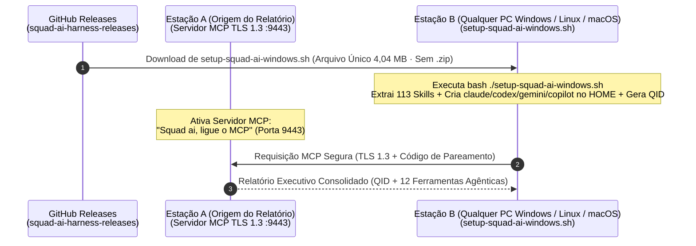

# Guia Oficial de Instalação Multi-Estação via GitHub Releases e Consulta Remota MCP (`SquadAI Harness`)

> **Versão:** `v1.0.113` · **Modo de Operação:** `Zero-Admin` / `Zero-ZIP` / `Zero-PowerShell` (Arquivo Único `.sh` Autossuficiente via Git Bash / Bash)
> **Repositório Oficial de Releases Públicas (SquadAI Harness — Official Releases):** [`https://github.com/thiago701/squad-ai-harness-releases`](https://github.com/thiago701/squad-ai-harness-releases)
> **Instaladores Oficiais de Arquivo Único (`4,04 MB` com as 113 Skills Embutidas):** `setup-squad-ai-windows.sh` (Windows) · `setup-squad-ai-linux.sh` (Linux) · `setup-squad-ai-macos.sh` (macOS)

---

## 1. Objetivo e Arquitetura

Este documento descreve o procedimento padronizado para instalar a **SquadAI Harness (`v1.0.113`)** em **qualquer computador Windows (10 ou 11), Linux ou macOS** — com ou sem GPU dedicada, sem exigir privilégios de Administrador, **sem precisar clonar o repositório**, **sem precisar descompactar arquivos `.zip`** e **sem depender do Windows PowerShell (`powershell.exe` / `.ps1`)** — a partir do repositório público oficial (**SquadAI Harness — Official Releases** · `squad-ai-harness-releases`), permitindo:

1. **Instalação Autossuficiente em Arquivo Único (`setup-squad-ai-windows.sh` no Git Bash):**
   - O arquivo `setup-squad-ai-windows.sh` (`4,04 MB`) traz **embutido todo o catálogo das 113 skills completas** (`SKILL.md` + `references/` + `scripts/` + `assets/`, totalizando 968 arquivos comprimidos em `tar.gz` Base64).
   - **Pastas Padrão Criadas no `$HOME` (`claude`, `codex`, `gemini` e `copilot`):** Mesmo que ainda não existam na máquina, cria automaticamente no `$HOME` (`%USERPROFILE%`) os diretórios `~/.claude/skills`, `~/.codex/skills`, `~/.gemini/config/skills`, `~/.gemini/skills` e `~/.copilot/skills` contendo as **113 skills instaladas**. As demais ferramentas (`~/.cursor`, `~/.codeium/windsurf`, `~/.cline`, `~/.qwen`, `~/.dsh`, `~/.opencode` e `Workstation CLI`) só são provisionadas se o diretório raiz da ferramenta existir de fato no computador.
   - **Desinstalação Seletiva (`--uninstall`):** Remove **apenas as skills pertencentes à SquadAI**, preservando 100% das skills autorais do desenvolvedor em todas as ferramentas (inclusive no `Workstation CLI`).
   - **Confirmação Explícita no Final:** Exibe banner visual **`[SUCESSO]`** ou **`[FALHA]`** ao encerrar a execução.
2. **Comunicação MCP Segura e Consulta Remota de Relatórios entre Estações (`TLS 1.3`):**
   - Qualquer estação autorizada (`Estação B`) pode consultar em tempo real o **Relatório Executivo de Uso, Horas e Economia de Tokens (`squad_usage_report`)** e o **Diagnóstico de Hardware (`diagnostics.remote`)** de outra estação (`Estação A`) na mesma rede local (LAN) ou VPN/Tailscale.



---

## 2. Passo 1 — Obter o Instalador (Baixando o Repositório ou via GitHub Releases)

Os scripts instaladores (**`setup-squad-ai.sh`**, **`setup-squad-ai-windows.sh`**, **`setup-squad-ai-linux.sh`** e **`setup-squad-ai-macos.sh`**) ficam **mantidos diretamente na raiz do repositório** (além da aba **Releases**), permitindo instalar em **qualquer Sistema Operacional (Windows, Linux, macOS)** mesmo em redes corporativas que bloqueiam downloads de `releases/download`:

### Opção A — Baixando ou Clonando o Repositório (Recomendado)

1. Clone o repositório (ou clique no botão verde **`<> Code -> Download ZIP`** na página principal do repositório no GitHub):
   ```bash
   git clone https://github.com/thiago701/squad-ai-harness-releases.git
   cd squad-ai-harness-releases
   ```
2. Execute o script `.sh` diretamente da raiz do repositório no seu Sistema Operacional:
   ```bash
   # Windows 10 / 11 (Git Bash):
   bash ./setup-squad-ai-windows.sh

   # Linux (Ubuntu, Debian, Mint, RHEL, Fedora, WSL2):
   bash ./setup-squad-ai-linux.sh

   # macOS (Apple Silicon M1–M4 & Intel):
   bash ./setup-squad-ai-macos.sh

   # Ou use o instalador universal presente na raiz:
   bash ./setup-squad-ai.sh
   ```

### Opção B — Download Direto do Arquivo Único na Aba Releases (Sem Clonar Repositório)

1. Acesse a página oficial de Releases do repositório público (**SquadAI Harness — Official Releases**):
   - **`https://github.com/thiago701/squad-ai-harness-releases/releases/latest`**
2. Baixe apenas o instalador de arquivo único correspondente ao seu Sistema Operacional:
   - **Windows 10 / 11 (Git Bash):** **`setup-squad-ai-windows.sh`** (`4,04 MB`)
   - **Linux (Ubuntu / Debian / Mint / WSL2 / Fedora):** **`setup-squad-ai-linux.sh`** (`4,04 MB`) ou **`squad-ai-harness_1.0.113_amd64.deb`**
   - **macOS (Apple Silicon M1–M4 & Intel):** **`setup-squad-ai-macos.sh`** (`4,04 MB`)
3. *(Opcional)* Confira a integridade do arquivo com o `SHA256SUMS.txt` publicado na Release (via Git Bash / Terminal):
   ```bash
   sha256sum setup-squad-ai-windows.sh
   ```

---

## 3. Passo 2 — Executar o Assistente de Instalação (`setup-squad-ai-*.sh`)

1. Abra o **Git Bash** (Windows) ou **Terminal** (Linux/macOS) na pasta do repositório ou onde baixou o script `.sh`.
2. Execute o Setup Wizard interativo ou passe a flag desejada:
   ```bash
   # Modo Interativo (Menu [1] INSTALAR, [2] REINSTALAR, [3] DESINSTALAR, [4] AUDITORIA, [5] LIGAR MCP, [6] VALIDAR PORTA, [7] RELATORIO MCP):
   bash ./setup-squad-ai-windows.sh

   # Instalação Licenciada 100% Offline das 113 Skills (valida a chave de licença individual e descriptografa o catálogo AES-256):
   bash ./setup-squad-ai-windows.sh --install --pin <CHAVE_LICENCA_INDIVIDUAL>

   # Reinstalar / Atualizar preservando o Identificador (QID):
   bash ./setup-squad-ai-windows.sh --reinstall --pin <CHAVE_LICENCA_INDIVIDUAL>

   # Auditoria de Homologação Corporativa InfoSec/GRC (8 Gates em Sandbox):
   bash ./setup-squad-ai-windows.sh --audit

   # Consultar status de MCP / Porta / Relatório MCP:
   bash ./setup-squad-ai-windows.sh --serve-mcp
   bash ./setup-squad-ai-windows.sh --check-port
   bash ./setup-squad-ai-windows.sh --report-mcp

   # Desinstalação Seletiva (remove apenas as skills da SquadAI, preservando as skills do dev):
   bash ./setup-squad-ai-windows.sh --uninstall
   ```
3. No modo interativo, o menu exibido na ordem de fluxo operacional (`LIGAR MCP > VALIDAR PORTA > RELATORIO MCP`) é:

```text
===============================================================================
  SQUAD AI HARNESS v1.0.113 — SETUP WIZARD OFICIAL (MULTI-OS / ZERO-ADMIN)
===============================================================================
  Estacao / SO        : <NOME-DO-COMPUTADOR> (Usuario: <SEU-USUARIO>)
  Identificador (QID) : QUID-SQ8-XXXXXXXX-XXXXXXXX
-------------------------------------------------------------------------------
  [1] INSTALAR      - Instalacao Limpa + Relatorio de Onde Instalou (113 Skills)
  [2] REINSTALAR    - Reparar / Atualizar preservando QID (Incrementa Geracao)
  [3] DESINSTALAR   - Remocao Seletiva (Mantem skills autorais do dev)
  [4] AUDITORIA     - Homologacao Corporativa InfoSec / GRC (8 Gates em Sandbox)
  [5] LIGAR MCP     - Iniciar Servidor MCP Peer nesta Estacao (Porta 9443)
  [6] VALIDAR PORTA - Verificar se a Porta 9443 esta Liberada no Equipamento Externo
  [7] RELATORIO MCP - Consultar Relatorio Executivo MCP Remoto (curl)
  [0] SAIR          - Encerrar o Setup Wizard
```

4. Ao final da execução, o instalador exibe a **mensagem de confirmação explícita de sucesso ou falha**:

```text
===============================================================================
  [SUCESSO] OPERACAO CONCLUIDA COM EXITO NO SETUP-SQUAD-AI.SH!
  Detalhes : Instalacao concluida (113 skills provisionadas; defaults: claude, codex, gemini e copilot no HOME)
===============================================================================
```

---

## 4. Passo 3 — Ativar o Servidor MCP na Estação de Origem (`Estação A`)

Para permitir que outro computador (`Estação B`) consulte remotamente o **Relatório Executivo da SquadAI** ou o **Diagnóstico de Hardware** da `Estação A`:

1. Na **`Estação A`**, execute o comando por linguagem natural no CMD ou Git Bash:

```cmd
squad-harness.exe "Squad ai, ligue o MCP"
```

*(Ou execute a forma explícita parametrizando o nome lógico da estação e o código de pareamento desejado):*

```cmd
squad-harness.exe peer serve --station <NOME-DA-ESTACAO-A> --addr 127.0.0.1:9443 --pair-code <CODIGO-PAREAMENTO>
```

2. O terminal da `Estação A` confirmará que o servidor MCP `TLS 1.3` está ativo na porta `9443`:

```text
======================================================================
  SQUAD-AI HARNESS — SERVIDOR MCP PEER ATIVO (TLS 1.3 mTLS)
======================================================================
  Endpoint Escuta    : https://127.0.0.1:9443/mcp/v1/stream
  Código Pareamento  : <CODIGO-PAREAMENTO>
  Tools Publicadas   : squad_usage_report, diagnostics.remote, peers.health
======================================================================
```

3. Anote o endereço IP da `Estação A` na rede local ou VPN/Tailscale (obtido com `ipconfig` no Windows).

---

## 5. Passo 4 — Validar a Porta e Consultar o Relatório MCP Remoto (`Estação B`)

Na **`Estação B`** (onde você executou `setup-squad-ai-windows.sh`), siga o fluxo **`[5] LIGAR MCP -> [6] VALIDAR PORTA -> [7] RELATORIO MCP`**:

### Maneira 1 — Pelo próprio Assistente `setup-squad-ai-windows.sh`

1. Primeiro (opcional), escolha **`[6] VALIDAR PORTA`** para testar em 4 etapas se o endpoint da `Estação A` (porta `9443` LAN) ou do servidor corporativo (porta `443`) está acessível e com Canal Seguro `TLS 1.3 + PQC` operacional.
2. Em seguida, escolha a opção **`[7] RELATORIO MCP`** no menu interativo:
   ```text
   IP da Estacao ou URL AWS Control Plane (Padrao = 127.0.0.1): <IP-DA-ESTACAO-A-OU-URL-AWS>
   ```
3. Digite o IP da `Estação A` (ou a URL HTTPS do servidor AWS da Opção 1) e pressione **`ENTER`**.
4. O Assistente conectará via **Canal Seguro (`TLS 1.3 + Assinatura Híbrida PQC Ed25519/ML-DSA-65`)** e exibirá na tela da `Estação B` o **Relatório Executivo da SquadAI** seguido da **Descoberta de Instalações Ativas no Realm**:
   - **`Identificador (QID)`** da estação consultada;
   - Horas trabalhadas com IA vs. Horas economizadas (últimos 3 meses);
   - Economia de tokens e economia financeira em USD;
   - Tabela de consolidação das **12 ferramentas agênticas**.

### Maneira 2 — Via Linha de Comando (Git Bash / Windows CMD)

- **Em qualquer estação (usando `curl` no Git Bash ou `curl.exe` no CMD):**
  ```bash
  curl -s -S -H "X-Squad-Pair-Code: <CODIGO-PAREAMENTO>" -H "X-Squad-Station: Estacao-Cliente" https://<IP-DA-ESTACAO-A>:9443/mcp/v1/report
  ```
- **Em estações com o binário `squad-harness.exe` (pareamento mútuo `mTLS` completo):**
  ```cmd
  :: Obter o Relatório Executivo de Uso (QID):
  squad-harness.exe peer query --station <NOME-ESTACAO-B> --remote https://<IP-DA-ESTACAO-A>:9443 --pair-code <CODIGO-PAREAMENTO> --tool squad_usage_report

  :: Obter o Relatório de Diagnóstico de Hardware e GPU:
  squad-harness.exe peer query --station <NOME-ESTACAO-B> --remote https://<IP-DA-ESTACAO-A>:9443 --pair-code <CODIGO-PAREAMENTO> --tool diagnostics.remote
  ```

---

## 6. Solução de Problemas Comuns (Troubleshooting)

| Sintoma | Causa Provável | Solução Recomendada |
|---|---|---|
| Timeout ao conectar em `https://<IP-DA-ESTACAO-A>:9443` | Os computadores estão em sub-redes isoladas (Wi-Fi corporativo/visitante com *AP Isolation*) ou o Firewall local bloqueou a porta `9443`. | Na `Estação A`, permita o acesso para **Redes Privadas** quando o Windows Defender Firewall solicitar, ou utilize uma rede overlay autenticada (**Tailscale** / túnel SSH local `ssh -L 9443:127.0.0.1:9443 usuario@<IP-DA-ESTACAO-A>`). |
| `ERR_INVALID_PAIR_CODE` | O código `--pair-code` informado na `Estação B` não coincide com o código iniciado na `Estação A`. | Certifique-se de utilizar o mesmo código de pareamento em ambas as pontas (`<CODIGO-PAREAMENTO>`). |
| Bloqueio corporativo de PowerShell (`.ps1` / `ExecutionPolicy`) | Estações corporativas frequentemente bloqueiam a execução de scripts `.ps1` baixados da internet (`Zone.Identifier`). | O instalador `v1.0.113` **não utiliza PowerShell nem `.zip`**: execute diretamente **`bash ./setup-squad-ai-windows.sh`** no Git Bash. |
