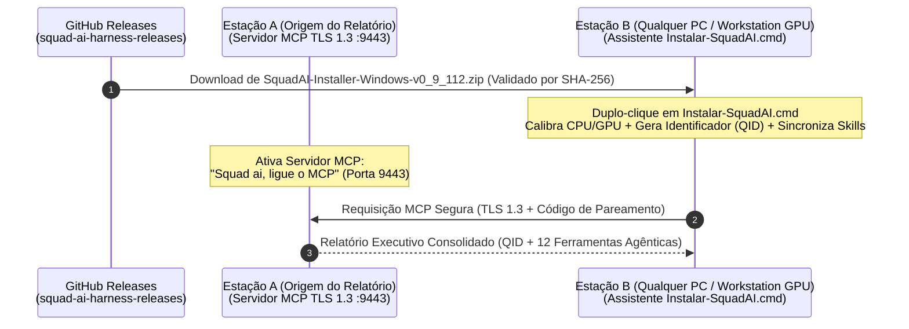

# Guia Oficial de Instalação Multi-Estação e Consulta Remota via MCP (`SquadAI Harness`)

> **Versão:** `v0.9.112` · **Modo de Operação:** `Zero-Admin` / `Zero-EXE` / `Zero-PowerShell` (100% Nativo em Windows CMD e Git Bash)
> **Repositório Oficial de Releases Públicas (SquadAI Harness — Official Releases):** [`https://github.com/thiago701/squad-ai-harness-releases`](https://github.com/thiago701/squad-ai-harness-releases)
> **Pacote Oficial de Release Windows:** `SquadAI-Installer-Windows-v0_9_112.zip`

---

## 1. Objetivo e Arquitetura

Este documento descreve o procedimento padronizado para instalar a **SquadAI Harness** em **qualquer computador Windows (10 ou 11)** — com ou sem GPU dedicada, sem exigir privilégios de Administrador e **sem depender do Windows PowerShell (`powershell.exe` / `.ps1`)** — a partir do repositório público oficial (**SquadAI Harness — Official Releases** · `squad-ai-harness-releases`), permitindo:

1. **Instalação e Calibração Local via CMD (`Instalar-SquadAI.cmd`) ou Git Bash (`setup-squad-ai.sh`):**
   - Detecção e calibração automática de **CPU, Memória RAM, GPU dedicada (`NVIDIA CUDA`), GPU integrada (`Intel Shared iGPU`) e NPU**.
   - Geração do **Identificador (`QID`)** único da estação (`QUID-SQ8-...`) e sincronização dos *stubs* MCP nas 12 ferramentas agênticas instaladas no perfil do usuário (`%USERPROFILE%`).
   - Operação **100% compatível com políticas corporativas restritas (`Zero-EXE` / `Zero-PowerShell` / `Zero-Admin`)**, imune a bloqueios de `ExecutionPolicy` ou `Zone.Identifier`.
2. **Comunicação MCP Segura e Consulta Remota de Relatórios entre Estações (`TLS 1.3`):**
   - Qualquer estação autorizada (`Estação B`) pode consultar em tempo real o **Relatório Executivo de Uso, Horas e Economia de Tokens (`squad_usage_report`)** e o **Diagnóstico de Hardware (`diagnostics.remote`)** de outra estação (`Estação A`) na mesma rede local (LAN) ou VPN/Tailscale.



---

## 2. Passo 1 — Baixar o Instalador Oficial no Computador de Destino

Em qualquer computador Windows onde deseje instalar a SquadAI Harness (sem precisar clonar código-fonte):

### Opção A — Download Direto via GitHub Releases (Recomendado)

1. Acesse a página oficial de Releases do repositório público (**SquadAI Harness — Official Releases**):
   - **`https://github.com/thiago701/squad-ai-harness-releases/releases/latest`**
2. Baixe o pacote empacotado correspondente à versão atual:
   - **`SquadAI-Installer-Windows-v0_9_112.zip`**
   - *(Opcional)* Confira a integridade do pacote com o arquivo `SHA256SUMS.txt` publicado na Release (no CMD ou Git Bash):
     ```cmd
     certutil -hashfile SquadAI-Installer-Windows-v0_9_112.zip SHA256
     ```
     ```bash
     sha256sum SquadAI-Installer-Windows-v0_9_112.zip
     ```
3. Extraia o arquivo `SquadAI-Installer-Windows-v0_9_112.zip` em qualquer pasta do seu usuário (ex.: `C:\Users\<seu-usuario>\SquadAI`).

### Opção B — Download via Linha de Comando (Windows CMD ou Git Bash)

Se preferir baixar e extrair automaticamente pelo **CMD** ou **Git Bash** (sem privilégio de Administrador e sem PowerShell):

```cmd
curl.exe -L -o "%USERPROFILE%\Downloads\SquadAI-Installer-Windows-v0_9_112.zip" "https://github.com/thiago701/squad-ai-harness-releases/releases/latest/download/SquadAI-Installer-Windows-v0_9_112.zip"
mkdir "%LOCALAPPDATA%\SquadAI\installer" 2>nul
tar.exe -xf "%USERPROFILE%\Downloads\SquadAI-Installer-Windows-v0_9_112.zip" -C "%LOCALAPPDATA%\SquadAI\installer"
explorer.exe "%LOCALAPPDATA%\SquadAI\installer"
```

---

## 3. Passo 2 — Executar o Assistente de Instalação (CMD ou Git Bash)

1. Abra a pasta onde o pacote `SquadAI-Installer-Windows-v0_9_112.zip` foi extraído.
2. Escolha uma das 2 formas nativas (Zero-PowerShell):
   - **Duplo-clique em `Instalar-SquadAI.cmd`** (abre o menu interativo no `cmd.exe`);
   - **No Git Bash:** execute `./setup-squad-ai.sh`.
3. O **Assistente de Instalação Windows** será exibido no terminal:

```text
===============================================================================
  SQUAD AI HARNESS v0.9.112 - ASSISTENTE DE INSTALACAO (MODO PURO CMD / BASH)
  Seguranca Corporativa: Zero PowerShell (.ps1) | Escopo Usuario (%USERPROFILE%)
===============================================================================
  Estacao Detectada   : <NOME-DO-COMPUTADOR> (Usuario: <SEU-USUARIO>)
  Identificador (QID) : QUID-SQ8-XXXXXXXX-XXXXXXXX
-------------------------------------------------------------------------------
  Escolha uma operacao do ciclo de vida (ou pressione ENTER para [1] Instalar):
    [1] INSTALAR    - Instalacao Limpa e Ativacao Licenciada (13 Passos)
    [2] REINSTALAR  - Reparar / Atualizar preservando QID (Incrementa Geracao)
    [3] DESINSTALAR - Remocao Completa e Limpeza Zero-Residuos
    [4] AUDITORIA   - Homologacao Corporativa InfoSec / GRC (8 Gates)
    [5] RELATORIO   - Consultar Relatorio Executivo MCP Remoto (curl.exe)
    [0] SAIR

  Digite [0-5] (Padrao = 1):
```

4. **Pressione `ENTER`** (opção `1`). O Assistente realizará automaticamente:
   - **Geração do Identificador (`QID`):** Cria o identificador único da estação (`QUID-SQ8-...`) em `%USERPROFILE%\.squad-ai\station-profile.json`.
   - **Sincronização Multi-Ferramenta Agêntica (13 Passos):** Instala o catálogo e sincroniza as ferramentas agênticas detectadas na estação (Claude Code, Google Antigravity, Cursor, GitHub Copilot, OpenAI Codex, Windsurf, Gemini CLI, etc.).

---

## 4. Passo 3 — Ativar o Servidor MCP na Estação de Origem (`Estação A`)

Para permitir que outro computador (`Estação B`) consulte remotamente o **Relatório Executivo da SquadAI** ou o **Diagnóstico de Hardware** da `Estação A`:

1. Na **`Estação A`** (o computador que possui o relatório que você deseja consultar), execute o comando por linguagem natural no CMD ou Git Bash:

```cmd
squad-harness.exe "Squad ai, ligue o MCP"
```

*(Ou execute a forma explícita parametrizando o nome lógico da estação e o código de pareamento desejado):*

```cmd
squad-harness.exe peer serve --station <NOME-DA-ESTACAO-A> --addr 0.0.0.0:9443 --pair-code SQUAD-LAB-2026
```

2. O terminal da `Estação A` confirmará que o servidor MCP `TLS 1.3` está ativo na porta `9443`:

```text
======================================================================
  SQUAD-AI HARNESS — SERVIDOR MCP PEER ATIVO (TLS 1.3 mTLS)
======================================================================
  Endpoint Escuta    : https://[::]:9443/mcp/v1/stream
  Código Pareamento  : SQUAD-LAB-2026
  Tools Publicadas   : squad_usage_report, diagnostics.remote, peers.health
======================================================================
```

3. Anote o endereço IP da `Estação A` na rede local ou VPN/Tailscale (obtido com `ipconfig` no Windows).

---

## 5. Passo 4 — Consultar o Relatório Remoto a partir de Qualquer Computador (`Estação B`)

Na **`Estação B`** (onde você acabou de rodar o instalador `Instalar-SquadAI.cmd` ou `./setup-squad-ai.sh`), você pode consultar o relatório da `Estação A` de duas maneiras:

### Maneira 1 — Pelo próprio Assistente `Instalar-SquadAI.cmd` ou `setup-squad-ai.sh`

1. Ao final da instalação (ou escolhendo a opção **`3`** no menu):
   ```text
   Informe o IP ou Hostname da Estacao com MCP ativo: <IP-DA-ESTACAO-A>
   ```
2. Digite o IP da `Estação A` e pressione **`ENTER`**.
3. O Assistente conectará via HTTPS (`TLS 1.3`) na porta `9443` da `Estação A` e exibirá na tela da `Estação B` o **Relatório Executivo da SquadAI** completo:
   - **`Identificador (QID)`** da estação consultada;
   - Horas trabalhadas com IA vs. Horas economizadas (últimos 3 meses);
   - Economia de tokens e economia financeira em USD;
   - Tabela de consolidação das **12 ferramentas agênticas**.

### Maneira 2 — Via Linha de Comando (Windows CMD / Git Bash)

- **Em qualquer estação Windows (usando `curl.exe` nativo no CMD ou `curl` no Git Bash):**
  ```cmd
  curl.exe -s -S -k -H "X-Squad-Pair-Code: SQUAD-LAB-2026" -H "X-Squad-Station: Estacao-Cliente" https://<IP-DA-ESTACAO-A>:9443/mcp/v1/report
  ```
- **Em estações com o binário `squad-harness.exe` (pareamento mútuo `mTLS` completo):**
  ```cmd
  :: Obter o Relatório Executivo de Uso (QID):
  squad-harness.exe peer query --station <NOME-ESTACAO-B> --remote https://<IP-DA-ESTACAO-A>:9443 --pair-code SQUAD-LAB-2026 --tool squad_usage_report

  :: Obter o Relatório de Diagnóstico de Hardware e GPU:
  squad-harness.exe peer query --station <NOME-ESTACAO-B> --remote https://<IP-DA-ESTACAO-A>:9443 --pair-code SQUAD-LAB-2026 --tool diagnostics.remote
  ```

---

## 6. Solução de Problemas Comuns (Troubleshooting)

| Sintoma | Causa Provável | Solução Recomendada |
|---|---|---|
| Timeout ao conectar em `https://<IP-DA-ESTACAO-A>:9443` | Os computadores estão em sub-redes isoladas (Wi-Fi corporativo/visitante com *AP Isolation*) ou o Firewall local bloqueou a porta `9443`. | Na `Estação A`, permita o acesso para **Redes Privadas** quando o Windows Defender Firewall solicitar, ou utilize uma rede overlay autenticada (**Tailscale** / túnel SSH local `ssh -L 9443:127.0.0.1:9443 usuario@<IP-DA-ESTACAO-A>`). |
| `ERR_INVALID_PAIR_CODE` | O código `--pair-code` informado na `Estação B` não coincide com o código iniciado na `Estação A`. | Certifique-se de utilizar o mesmo código de pareamento em ambas as pontas (padrão: `SQUAD-LAB-2026`). |
| Bloqueio corporativo de PowerShell (`.ps1` / `ExecutionPolicy`) | Estações corporativas frequentemente bloqueiam a execução de scripts `.ps1` baixados da internet (`Zone.Identifier`). | O instalador `v0.9.112` **não utiliza PowerShell**: execute diretamente **`Instalar-SquadAI.cmd`** (CMD nativo) ou **`./setup-squad-ai.sh`** (Git Bash). |
